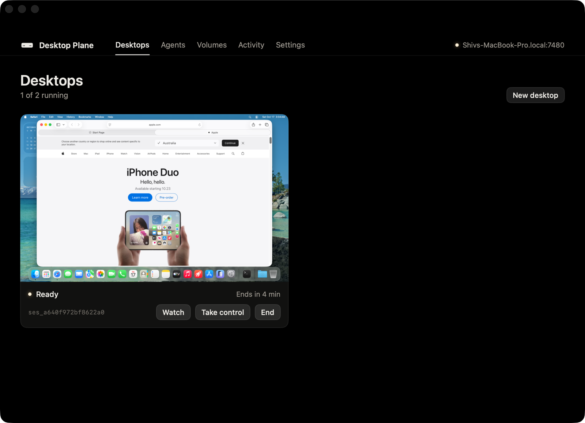

# Desktop Plane

Turn a spare Mac into macOS desktops your AI agents can use.

Your agents keep running on your own computer. When one needs to use a Mac app, it asks
Desktop Plane for a desktop: a fresh macOS virtual machine on the spare Mac, ready in seconds.
The agent sees the screen, clicks and types through MCP, and the desktop is deleted when it's
done.



- **Any MCP agent.** Claude Code, Codex, or your own: anything that speaks MCP over HTTP.
- **Fresh every time.** Each desktop is a copy-on-write clone of one golden image. Nothing
  carries over unless you attach a [volume](#volumes).
- **Fast.** A desktop restores from a snapshot in about 6–9 seconds.
- **Sealed off.** Desktops can't reach each other, the Mac, or your network. They reach the
  internet only through a filtering proxy.
- **One Swift package, no dependencies.** A menu bar app, a command-line host, and a small
  agent inside each VM.

## How it works

```
 your computer                          spare Mac
┌──────────────────┐   MCP over HTTP   ┌────────────────────────────────────────────┐
│ Claude Code,     │ ────────────────▶ │ Desktop Plane  /v1/mcp                     │
│ Codex, any agent │   Tailscale or    │   ├─ desktop 1  macOS VM  (arc-cua driver) │
└──────────────────┘   local network   │   └─ desktop 2  macOS VM  (arc-cua driver) │
                                       └────────────────────────────────────────────┘
```

Inside each desktop, the [arc-cua](https://github.com/shhivv/arc-cua) driver reads windows
through the accessibility API and acts on them. Desktop Plane forwards its tools to your agent
and adds tools to start, list, screenshot and end desktops.

macOS allows two macOS VMs at a time on one Mac, so one Mac runs up to two desktops at once.

## Requirements

- A Mac with Apple silicon, macOS 14 or later (macOS 15 or later for volumes)
- About 60 GB of free disk space
- 16 GB of memory for two desktops at once; 8 GB runs one

## Install

1. Download the DMG from [Releases](https://github.com/shhivv/desktop-plane/releases), drag
   **Desktop Plane** to Applications, and open it.
2. Follow the setup in the window. It takes 20–40 minutes, most of it the macOS download.
   - **Install macOS.** Downloads macOS (about 17 GB) into a virtual machine.
   - **Set up macOS.** Finish Setup Assistant in the VM, type the install command shown into
     Terminal, allow Accessibility and Screen Recording, then shut the VM down.
   - **Save a snapshot.** New desktops start from it.
   - **Turn on network access.** Tailscale (recommended) or your local network.
   - **Connect your agent.** Copy the URL and header shown.
3. In Settings, turn on **Open at login**, and turn on automatic login for the Mac's user, so
   desktops are available after a restart.

## Connect an agent

Add Desktop Plane as an MCP server in your agent's settings, on the computer where the agent
runs. Use the Streamable HTTP transport with the URL and `Authorization` header from the app's
**Agents** tab.

Claude Code:

```bash
claude mcp add --scope user --transport http desktop-plane https://<mac>.<tailnet>.ts.net:7480/v1/mcp \
  --header "Authorization: Bearer <token>"
```

Codex, in `~/.codex/config.toml`:

```toml
[mcp_servers.desktop-plane]
url = "https://<mac>.<tailnet>.ts.net:7480/v1/mcp"
http_headers = { Authorization = "Bearer <token>" }
```

Then ask for something that needs a Mac:

> Start a desktop with Safari, open apple.com and tell me the headline.

The **Agents** tab shows each agent that connects and where it connects from.

### Tools your agent gets

| Tool | What it does |
|---|---|
| `desktop_create` | Start a desktop, optionally with apps or URLs open, a lifetime, network rules or a volume |
| `desktop_open` | Open apps or URLs on a desktop |
| `desktop_screenshot` | A PNG of the whole screen |
| `desktop_list`, `desktop_end` | See and end desktops |
| `observe`, `act`, `type_text`, `click_at`, `press`, `scroll_at`, … | The arc-cua driver: read a window as elements and act on them |
| `desktop_call` | Call any driver tool by name |

Driver tools take an optional `desktop` id. Leave it out while the agent has one desktop.

## Network access

Agents connect from another computer, so the Mac's API has to be reachable.

- **Tailscale (recommended).** Traffic is encrypted and works from anywhere on your tailnet.
  The app runs `tailscale serve` on the API's port and keeps the API itself on this Mac only.
  If your tailnet hasn't used Serve before, the app shows the link to turn it on.
- **Same network.** The API listens on your local network at `http://<mac>.local:7480`. Traffic,
  including the access token, is not encrypted. Use it only on a network you trust.

The access token gives full control of the host. Keep it private.

## Volumes

Desktops start fresh, but a volume carries files from one desktop to the next: a browser
profile, logins, downloads or work files. Create one in the **Volumes** tab, then pass its id
when starting a desktop. It mounts at `/Volumes/Data`.

- One desktop at a time can use a volume.
- Volume files are sparse, so they take only the space that's been written.
- Point apps at the volume to keep their data, for example Chrome with
  `--user-data-dir=/Volumes/Data/chrome`. Data apps keep in system locations, such as the
  keychain, doesn't carry over.

## Security

The design assumes code inside a desktop is hostile.

| From | To | What stops it |
|---|---|---|
| A desktop | Another desktop | No shared network. Each VM's network card is one end of a socket pair owned by the host, which only answers ARP and refuses everything else. |
| A desktop | This Mac, your LAN, cloud metadata | The only way out is an egress proxy over the VM's own vsock. It resolves names itself and refuses every non-public address, so DNS rebinding can't get through. |
| A desktop | The internet | Per-desktop rules: `allow` and `deny` host patterns and ports (80 and 443 by default). Every connection is logged. |
| A desktop | Your agents | The driver's tool list is read from your golden image when its snapshot is saved, never from a running desktop, and guest messages are size-limited. |
| One agent | Another agent's desktop | Calls without an id only reach the agent's own desktop. Ending a desktop you didn't start requires its id. |
| A web page | The API | Requests from a browser origin are refused. |
| The next desktop | The last one's data | VMs are never reused; ending a desktop deletes its clone. |
| A desktop | Files, clipboard, devices on this Mac | Desktops have no shared folders, clipboard, audio or Rosetta. The only USB device is the desktop's own volume. |

`planed selftest` boots two desktops and checks these from inside a real guest: blocked direct
access, proxy refusals, token scoping, clean teardown, clock sync and volume behaviour.

## Command line

`planed` is the same host without the window. It ships inside the app:

```bash
sudo ln -s "/Applications/Desktop Plane.app/Contents/MacOS/planed" /usr/local/bin/planed
```

```bash
planed serve                                # run the host without the app
planed mcp                                  # the MCP URL, header and agent commands
planed session new --open Safari --ttl 1800 # start a desktop
planed session list
planed session end ses_…
planed config                               # show settings
planed config set cpus=4 memory=8 slots=2 ttl=3600 idle=900
planed image install | provision | finalize # build the golden image without the app
planed image update-agent                   # update the agent inside the image
planed selftest
planed token                                # the access token
```

CPU and memory are part of the snapshot, so a change applies after you save a new snapshot.

<details>
<summary>HTTP API</summary>

All routes except `/v1/health` take `Authorization: Bearer <token>`. Session tokens, returned
when a session is created, open only their own session.

| Method | Path | Token | |
|---|---|---|---|
| GET | `/v1/health` | none | image stage, free slots |
| POST, DELETE | `/v1/mcp` | access | the MCP server agents use |
| POST | `/v1/sessions` | access | `ttl_seconds`, `idle_timeout_seconds`, `network: {enabled, allow, deny, ports}`, `volume`, `open` |
| GET | `/v1/sessions` | access | list |
| GET, DELETE | `/v1/sessions/:id` | access or session | |
| POST, DELETE | `/v1/sessions/:id/mcp` | access or session | the driver for one desktop, over MCP |
| GET | `/v1/sessions/:id/screenshot` | access or session | PNG |
| POST | `/v1/volumes` | access | `name`, `size_gb` (default 10) |
| GET | `/v1/volumes`, `/v1/volumes/:id` | access | size, bytes used, `attached_to` |
| DELETE | `/v1/volumes/:id` | access | refused while attached |

A desktop ends when it's deleted, when its lifetime passes, after its idle timeout (no requests
from an agent), or when the guest shuts down.

</details>

## Build from source

Requires Xcode 16 or later.

```bash
scripts/bundle.sh                 # dist/Desktop Plane.app, signed ad hoc
SIGN_ID="Developer ID Application: …" NOTARY_PROFILE=… scripts/release.sh   # signed, notarized DMG
scripts/dev.sh <planed args>      # debug planed with the virtualization entitlement
swift test
```

```
Sources/PlaneCore      wire formats, egress policy, dead-end LAN packets (unit-tested)
Sources/PlaneHost      VMs, image builder, sessions, egress proxy, HTTP API, MCP endpoint
Sources/planed         command-line host
Sources/DesktopPlane   the app
Sources/AgentLauncher  guest launcher that holds the guest's permissions
Sources/GuestAgent     agent inside each VM: control channel, MCP, screenshots, proxy forwarder
```

## License

MIT. Apple's macOS license allows up to two additional macOS instances in virtual machines on
a Mac you own, for purposes including development and testing. Read it before offering
desktops to other people.
